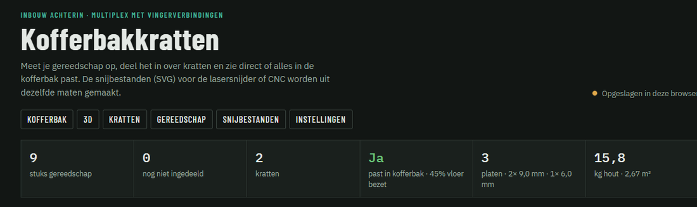
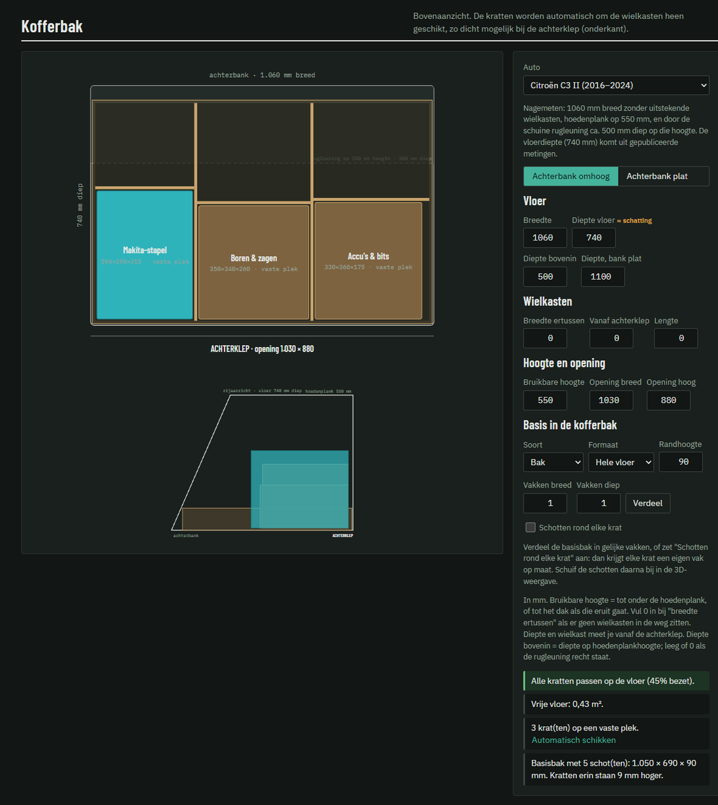
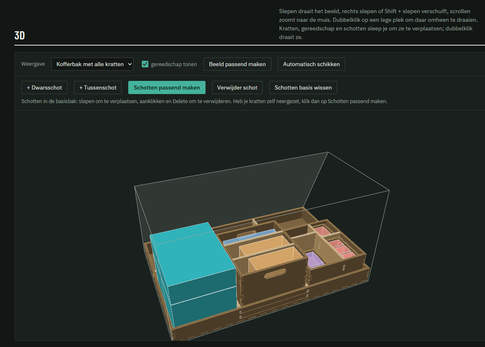
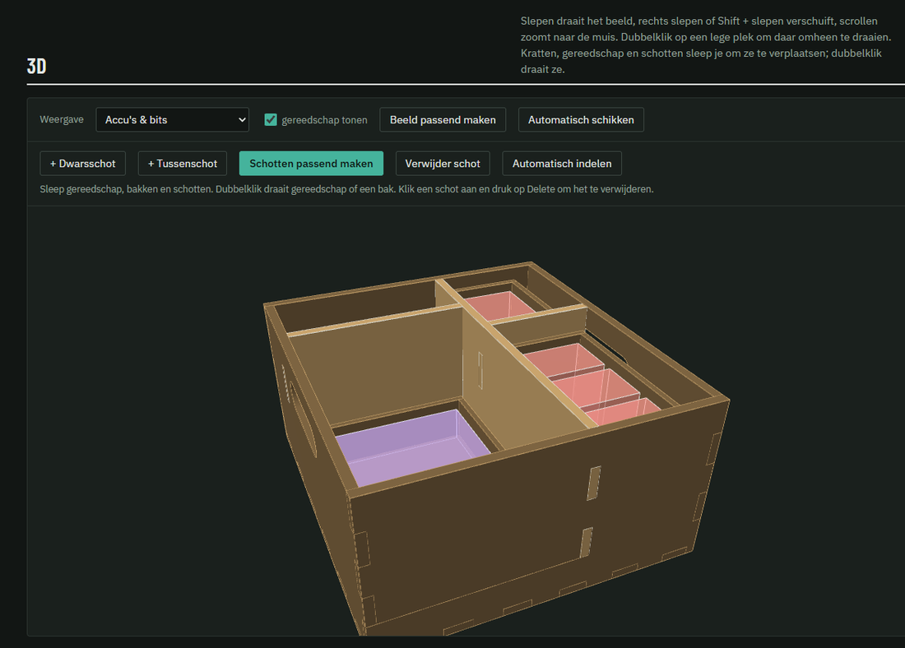
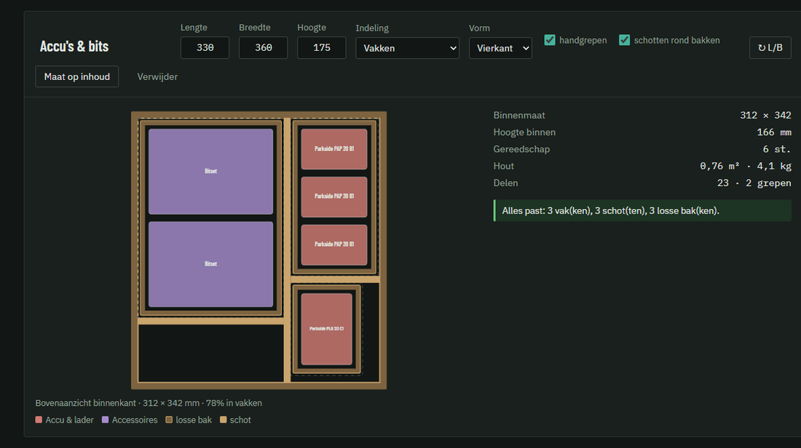
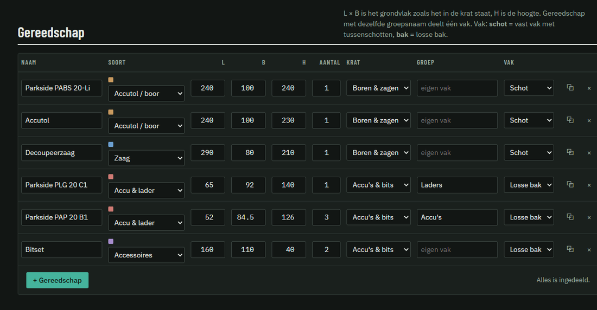
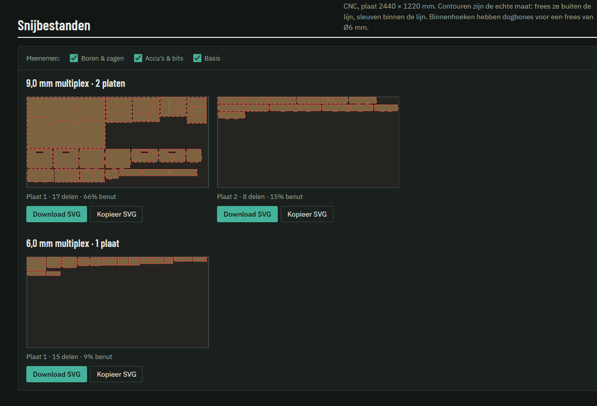

# CarBootCrateMaker

Een generator voor multiplex kratten en inbouw voor in de kofferbak, met vingerverbindingen voor de lasersnijder of CNC.
*A generator for finger-jointed plywood crates for your car boot (UI in Dutch).*

Je meet je gereedschap op (accutollen, zagen, schuurmachines, accessoires…), deelt het in over kratten en ziet direct of alles in de kofferbak past. Uit dezelfde maten komen de snijbestanden.

## Screenshots



**Kofferbak** – bovenaanzicht en zijaanzicht met schuine rugleuning, basisbak en Makita-stapel:



**3D** – kratten slepen en draaien, schotten passend maken:





**Krat** met vakken, schotten en losse bakken:



**Gereedschap** invoeren:



**Snijbestanden** per plaatdikte:



## Onderdelen

| Bestand | Wat |
|---|---|
| `index.html` | Planner in de browser. Openen door te dubbelklikken, werkt zonder internet of server. |
| `Kofferbakkrat.FCMacro` | FreeCAD-macro (1.x): bouwt de kratten in 3D en schrijft dezelfde SVG-snijbestanden. |
| `kofferbakkratten-gegevens.json` | Voorbeeld-back-up met gereedschap, te laden in de planner en de macro. |
| `tests/test_krat.py` | Geometrietest voor de macro, draait zonder venster in FreeCAD. |

## Planner (`index.html`)

- Gereedschap invoeren: naam, soort, L × B × H, aantal en krat.
- Per krat een bovenaanzicht van de indeling, met speling rondom en een waarschuwing als iets niet past of boven de rand uitsteekt. **Maat op inhoud** rekent de kleinste krat uit voor het toegewezen gereedschap. Daarbij gaat de voorkeur naar een maat waarvan alle panelen op de plaat passen.
- **Vakken:** elk gereedschap krijgt een eigen vak, en gereedschap met dezelfde *groep* deelt een vak. Per gereedschap kies je:
  - **Schot:** een vast vak. De krat wordt in stroken verdeeld met dwarsschotten van wand tot wand, met tussenschotten daarbinnen. Alle schotten steken met lipjes door sleuven in de wanden, de bodem en de dwarsschotten.
  - **Losse bak:** een uitneembare open bak met vingerverbindingen, standaard van 6 mm plaat. Accu's, laders, accessoires en handgereedschap gaan standaard in een losse bak.
- Zet **Indeling** op *Vrij* voor een krat zonder schotten.
- Kofferbak in bovenaanzicht: passen alle kratten op de vloer en onder de hoedenplank?
- Snijbestanden als SVG in echte millimeters, verdeeld over platen, met één set platen per plaatdikte.
- Gegevens worden in de browser bewaard. Via **Instellingen → Gegevens** maak je een back-up (JSON) of laad je er een in.

## FreeCAD-macro

1. Kopieer `Kofferbakkrat.FCMacro` naar je macromap. Die vind je via *Macro → Macro's…*, onder Windows meestal `%APPDATA%\FreeCAD\v1-1\Macro`.
2. *Macro → Macro's… → Kofferbakkrat → Uitvoeren*.
3. Vul de maten in, of kies **Back-up van webpagina inladen…** om alle kratten met gereedschap in de kofferbak op te bouwen.

Selecteer een bestaande krat voordat je de macro start om hem aan te passen. De 3D-onderdelen hebben de echte maat; kerfcompensatie en dogbones zitten alleen in de SVG's.

## Verbindingen en snijbestanden

- Open krat: voorkant, achterkant, twee zijkanten en bodem. Elke rand krijgt een oneven aantal gelijke vingers, rond de ingestelde vingerbreedte. Optioneel komt er een handgreep in de korte zijkanten.
- **Laser** (standaard de Trotec Speedy 360, werkveld 813 × 508 mm): de contour schuift een halve kerf naar buiten. Rood (`#ff0000`, haarlijn) is snijden, blauw (`#0000ff`) is graveren.
- **CNC**: de contour is de echte maat, dus frees buiten de lijn. Elke binnenhoek krijgt een dogbone voor de opgegeven freesdiameter.
- Meet je plaat na. 9 mm multiplex is in de praktijk vaak 8,7 tot 9,3 mm, en de plaatdikte bepaalt de vingerdiepte.
- Snij eerst een proefhoek en stel de kerf bij: groter maakt de passing strakker, kleiner losser.
- 9 mm multiplex is zwaar werk voor een CO₂-laser. Reken op een lage snelheid, vaak 2 passes, en een iets schuine snijkant.

## Test

```bash
"C:\Program Files\FreeCAD 1.1\bin\freecadcmd.exe" tests/test_krat.py
```

De test controleert bij meerdere maten dat de panelen niet overlappen, samen precies de wand vullen en de juiste buitenmaat hebben. Daarnaast checkt hij dat de SVG's geldig zijn en dat kerf en dogbones kloppen.
